<p align="center">
  <picture>
    <source media="(prefers-color-scheme: dark)" srcset="docs/screenshots/store/banner-dark.webp">
    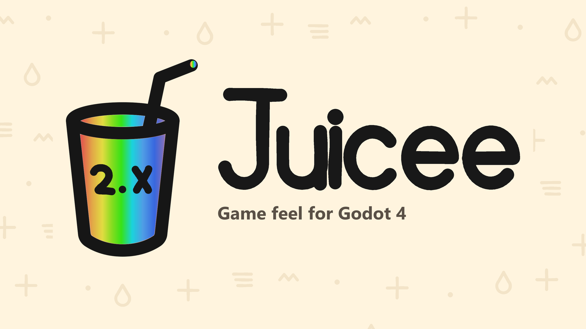
  </picture>
</p>

# 🧃 Juicee

Game feel for Godot 4. Screen shake, hit-stop, squash, particle bursts, damage numbers, and a bunch more. Fire them in one line, or stack them into sequences. Free and MIT.

[](https://godotengine.org)
[](LICENSE)
[](#whats-in-it)

<p align="center">
  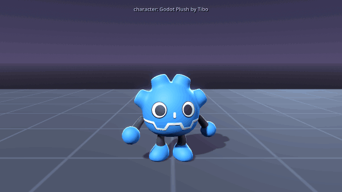<br>
  <sub>Its own animation clips and dust, with Juicee's squash and stretch, widening view on the run and landing shake on top. Character: <a href="https://github.com/gtibo/Godot-Plush-Character">Godot Plush Character</a> by Tibo, MIT</sub>
</p>

## Why not just tweens?

A single shake is five lines with a tween, and if that is all you need, write it. Juicee is for the moment effects collide, because that is where the bugs are:

- Two shakes at once on one camera both show, and leave it where it started, not where the first one left it.
- Two hit-stops in a row cannot leave `Engine.time_scale` stuck at zero.
- `stop()` halfway through takes the ducked music, the reverb and the full-screen overlay with it.
- A node freed in the middle of an effect is let go without an error.
- Two rumbles at once combine, instead of the second one cancelling the first.

What it does not do is blend a tween with a loop-driven effect on the same property: the tween wins. Juicee warns you when that happens, rather than letting the loop quietly do nothing.

## Quick start

The fastest way in is the singleton. Call it from anywhere:

<table>
  <tr>
    <td valign="middle">

```gdscript
Juicee.stretch(tomato, Vector2.UP)   # a smear as it launches
Juicee.trail(tomato)                 # a ghost trail through the arc
Juicee.hop(tomato, 50, 0.55)         # the hop itself
await get_tree().create_timer(0.15).timeout
Juicee.sparkle(tomato)               # a burst of stars at the top
await get_tree().create_timer(0.4).timeout
Juicee.squash_land(tomato)           # flatten on landing
await get_tree().create_timer(0.42).timeout
Juicee.jelly_wobble(tomato)          # a springy jelly settle
```

</td>
    <td width="44%" valign="middle">
      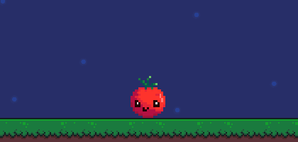
    </td>
  </tr>
</table>

If you'd rather not pick effects one by one, there are 12 presets that bundle a few together:

```gdscript
Juicee.preset_hit(enemy)
Juicee.preset_explosion(self)
Juicee.preset_level_up(self)
Juicee.preset_pickup(coin)
# ...and 8 more
```

## Three ways to use it

Same effects, three workflows. Pick whatever suits you:

- **Singleton:** one line from code, like above.
- **Inspector:** add a `JuiceePlayer` node and build a sequence with sliders, with a Preview button to try it without running the game. One player can hold several sequences and fire them by name, `play("hit")` or `play("death")`, the way an `AnimationPlayer` does.
  - Right-click any node in the Scene dock for an "Add JuiceePlayer" shortcut, one per node on a multi-selection (Godot 4.4 and up).
  - Park the player wherever it belongs: an effect that lands on the wrong kind of node looks for the right one nearby, so a player next to the sprite still bounces it.
  - A step that cannot work, a Sound with no streams or an effect with no node of its kind anywhere near, shows as a warning on the player in the Scene dock before you run anything.
- **Graph editor:** wire effects together in the JuiceeGraph bottom panel, with Trigger / Loop / Random / Split nodes for flow. Play the saved graph with `JuiceeGraphPlayer.play(graph, node)` and it runs with the branching intact, no flattening. A minimap, Align and Ctrl+F help once a graph outgrows the screen.

<table>
  <tr>
    <td width="50%" align="center" valign="top" rowspan="2">
      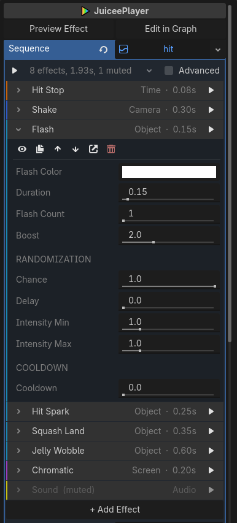<br>
      <sub><b>Inspector</b>: every row has its own play button, drags to reorder, and right-clicks to mute, duplicate or reset</sub>
    </td>
    <td width="50%" align="center" valign="top">
      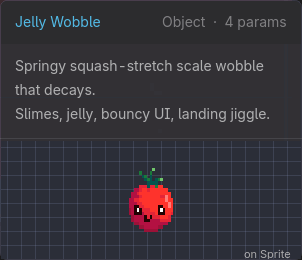<br>
      <sub><b>Hover a row</b> and the effect plays on a copy of your own sprite</sub>
    </td>
  </tr>
  <tr>
    <td align="center" valign="top">
      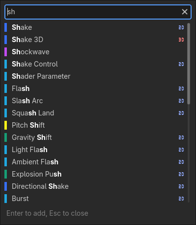<br>
      <sub><b>Add Effect</b>: all 117 by category, or type to search names and descriptions</sub>
    </td>
  </tr>
  <tr>
    <td colspan="2" align="center">
      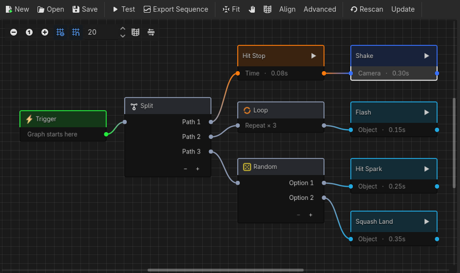<br>
      <sub><b>Graph editor</b>: Trigger, Split, Loop and Random for flow, effect blocks coloured by category</sub>
    </td>
  </tr>
</table>


Sequences and graphs are plain resources. A sequence goes on a `JuiceePlayer` or plays from code; a graph plays from code, or turns into a flat sequence with **Export Sequence** when it has no branching to keep.

With the game running, select a `JuiceePlayer` and change any value in the Inspector or the graph: the running game picks it up as you change it, so you tune by feel instead of relaunching. See [live-tuning.md](docs/live-tuning.md).

## Install

1. Get Juicee from the [Godot Asset Store](https://store.godotengine.org/asset/kelpekk/juicee/), or copy `addons/juicee/` from this repository into your project's `addons/` folder.
2. Project Settings > Plugins > enable Juicee.

Needs Godot 4.3 or newer; the test sweep runs on 4.3, 4.4, 4.6 and 4.7. Works in all three renderers (Forward+, Mobile, Compatibility).

To update, use **Update** in the JuiceeGraph toolbar, or delete `addons/juicee/` and install the new version. An update writes over that folder and a reinstall deletes it, so keep your own effects outside it (see `juicee/effect_folders` below). Coming from 1.x? Some defaults and timings changed, and [upgrading.md](docs/upgrading.md) says which and how to get the old look back.

<p align="center">
  <sub><a href="https://store.godotengine.org/asset/kelpekk/juicee/"><b>Juicee on the Godot Asset Store</b></a></sub><br>
  <a href="https://store.godotengine.org/asset/kelpekk/juicee/">
    <picture>
      <source media="(prefers-color-scheme: dark)" srcset="docs/screenshots/store-badge-dark.gif">
      
    </picture>
  </a>
</p>

## What's in it

<p align="center">
  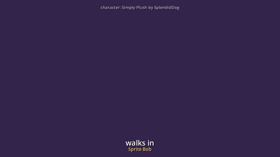<br>
  <sub>Pixel art at 128x72, scaled up by a whole number. Its own clips, with Juicee's squash and stretch, wobbles, breathing and bob on top. Character: <a href="https://splendiddog.itch.io/simply-plush">Simply Plush</a> by SplendidDog</sub>
</p>

117 effects across 8 categories. Eight of them, one call each on the quick start's tomato:

<p align="center">
  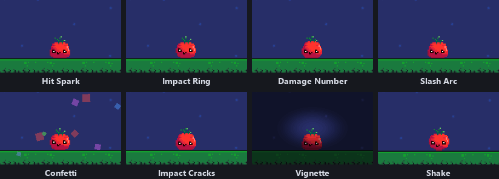<br>
  <sub><code>Juicee.hit_spark(tomato)</code>, <code>Juicee.damage_number(tomato, 42)</code> and so on, everything else left at its default</sub>
</p>

| Category | Count | Effects |
|---|---|---|
| **Screen** | 18 | Chromatic, Vignette, Blur, Pixelate, Glitch, Color Grade, Screen Tint, Screen Wipe, Bloom, Tonemap, Shockwave, Cinematic Bars, Scan Lines, Speed Lines, Film Grain, Radial Blur, Lens Distortion, Depth of Field |
| **Camera** | 9 | Shake (2D / 3D), Zoom, FOV 3D, Camera Follow, Directional Shake, Camera Bob, Zoom Pulse, Camera Rotation |
| **Object** | 50 | Flash, Modulate, Bounce, Jiggle, Position / Rotation (2D / 3D), Trail, Burst, Confetti, Light Flash, Spring, Ambient Flash, Strobe, Recoil, Outline, Color Cycle, Spin, Wiggle, Sprite Bob, Pop In, Shake Control, Pulse, Shader Parameter, Flicker, Scale, Scale 3D, Particle Control, Light 3D, Material 3D, Fade, Flip, Instantiate, Size Delta, Impact Ring, Sway, Squash Land, Hit Spark, Afterimage, Slash Arc, Impact Cracks, Sparkle, Jelly Wobble, Stretch, Glow Pulse, Heartbeat, Hop, Wobble Rotation, Breathe |
| **Text** | 8 | Damage Number, Floating Text, Button Punch, Typewriter, Number Count, Text Wobble, Text Scramble, Rich Text Emphasis |
| **Time** | 5 | Hit Stop, Time Scale Ramp, Delay, Freeze Frame, Stutter |
| **Audio** | 10 | Sound, Procedural Sound, Music Duck, Rumble, Reverb, Pitch Shift, Low-Pass, Audio Source 3D, Distortion, Tremolo |
| **Physics** | 5 | Impulse, Add Force (2D / 3D), Knockback, Explosion Push, Gravity Shift |
| **Flow** | 12 | Sequence, Property Tween, Animation Player, Set Active, Chain, Beat Sync, Wait For Input, Emit Signal, Debug Log, Animation Tree, Set Property, Auto Destruct |

### Every effect

Every effect has a few shared knobs: `chance`, `delay`, a random `intensity` range, `cooldown`, `enabled` to mute it, and `stop()` / `is_playing()`. Any single play can be scaled with `apply(node, {"intensity": 1.8})`, so a light hit and a heavy one share one sequence; effects that switch or time something rather than having a strength (Flip, Instantiate, Screen Wipe, the Flow steps and a few more) play the same either way.

Godot compiles a shader the first time it is drawn, so the first screen effect of a session can stall a frame. Call `await Juicee.warmup()` on a loading screen to pay that up front.

### Accessibility

<table>
  <tr>
    <td valign="middle">

Five global toggles for reduced motion, flashing, screen shake, chromatic and vibration, which every effect reads on its own, plus an overall intensity and a quality tier that thins out the particle-heavy effects for weaker hardware.

`addons/juicee/ui/accessibility_settings.tscn` drops all of it into an options menu as one node, and `Juicee.accessibility.to_dict()` / `from_dict()` carry it in and out of your save file.

</td>
    <td width="44%" valign="middle">
      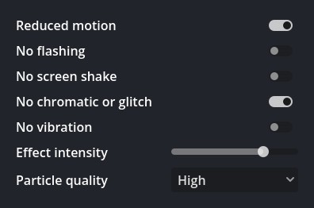
    </td>
  </tr>
</table>

### Advanced Properties

Turn on **Advanced Properties** (Project Settings > Juicee, or the checkbox in the inspector header) and every effect opens up: 289 more parameters across the library. Hand-drawn easing curves, shake presets, particle shapes, star shapes, audio properties Godot always had but Juicee never exposed. The switch only shows and hides them, so turning it on changes nothing by itself, and all but four default to what the effect already did; [upgrading.md](docs/upgrading.md#defaults-that-changed) names those four. See [advanced-properties.md](docs/advanced-properties.md).

## Project settings

Everything under **Project Settings > Juicee**:

| Setting | Default | What it does |
|---|---|---|
| `juicee/advanced_properties` | `false` | Reveal the extra 289 parameters on every effect. See [advanced-properties.md](docs/advanced-properties.md). |
| `juicee/effect_folders` | empty | Folders of your own effects, searched recursively. Everything in them extending `JuiceeEffect` joins the built-ins in the Inspector picker and the graph popup. Keep custom effects here rather than in `addons/juicee/effects/`, which an update can write over and a reinstall deletes. |
| `juicee/pixel_scale` | `1.0` | One multiplier for every pixel distance the effects move or spawn over, so a 32px pixel-art game and a 1080p one both read right from one place. Scale, rotation, colour and full-screen shader effects ignore it, they are already resolution-independent. Affects 13 effects, among them Shake, Burst, Confetti, Sparkle, Hit Spark, Floating Text, Hop and Wiggle. |
| `juicee/graph/effect_color_mode` | `Category` | Colour effect rows, blocks and picker entries by category, or by Dimension: 2D only, 3D only or both. |
| `juicee/graph/effect_tag_icons` | `Generic` | The 2D / 3D mark on an effect: one generic mark, or Per Category, the kind of node it wants (a Camera2D rather than any 2D node). |
| `juicee/preview/editor_hint_visible` | `true` | Show the amber outline marking the editor-preview area. |
| `juicee/preview/editor_border_color` | amber | Recolour that outline. |
| `juicee/preview/hover_panel_visible` | `true` | Show the hover info panel in the graph and the Inspector (name, description, mini preview, and on a graph block what the running game fired). |
| `juicee/preview/hover_show_description` | `true` | Show the description line inside that panel. |

## C#

The whole singleton API works from C# as well:

```csharp
Juicee.ShakeCamera(this, 12f, 0.3f);
Juicee.HitStop(this, 0.08f);
Juicee.PresetHitCrit(this);
```

You need the .NET build of Godot. See [docs/csharp.md](docs/csharp.md).

## Docs

| Page | What's in it |
|---|---|
| [effects-reference.md](docs/effects-reference.md) | every effect and its parameters |
| [api-reference.md](docs/api-reference.md) | every class, signal and shared parameter |
| [advanced-properties.md](docs/advanced-properties.md) | the extra 289 parameters and how to turn them on |
| [singleton-api.md](docs/singleton-api.md) | all the `Juicee.*` one-liners |
| [philosophy.md](docs/philosophy.md) | which of the three workflows fits when |
| [graph-editor.md](docs/graph-editor.md) | the graph panel |
| [csharp.md](docs/csharp.md) | using it from C# |
| [architecture.md](docs/architecture.md) | how it works inside |
| [how-to-write-effect.md](docs/how-to-write-effect.md) | writing your own effect |
| [live-tuning.md](docs/live-tuning.md) | tuning effects while the game runs |
| [multiplayer.md](docs/multiplayer.md) | using Juicee in a networked game |
| [procedural-sfx.md](docs/procedural-sfx.md) | the experimental chiptune sound generator |
| [upgrading.md](docs/upgrading.md) | coming from 1.x: what looks or times differently, and what to do first |
| [CHANGELOG.md](CHANGELOG.md) | what changed in each release |

## Contributing

Made an effect or preset worth sharing? Open a [PR](CONTRIBUTING.md), or post it in [Discussions](https://github.com/Kelpekk/Juicee/discussions).

## License

MIT. Use it in anything, free or commercial.

<p align="center">
  <picture>
    <source media="(prefers-color-scheme: dark)" srcset="docs/screenshots/store/juicee-logo-light.png">
    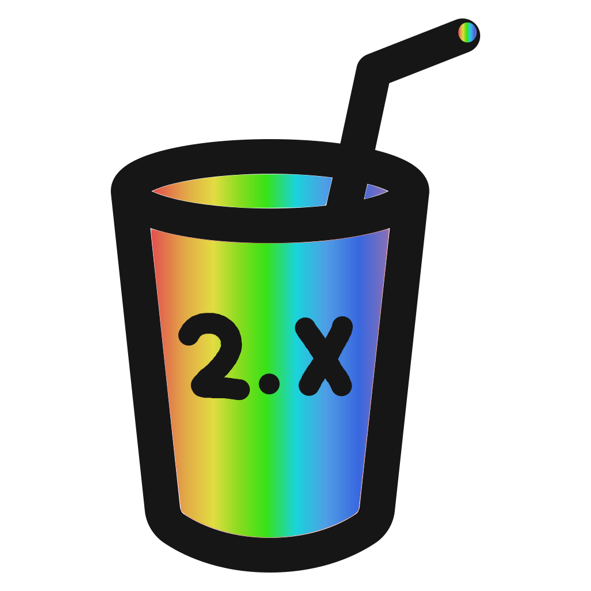
  </picture><br>
  <sub><a href="https://store.godotengine.org/asset/kelpekk/juicee/">Asset Store</a> · <a href="https://github.com/Kelpekk/Juicee/discussions">Discussions</a> · <a href="https://github.com/Kelpekk/Juicee/issues">Issues</a> · <a href="CHANGELOG.md">Changelog</a></sub>
</p>
